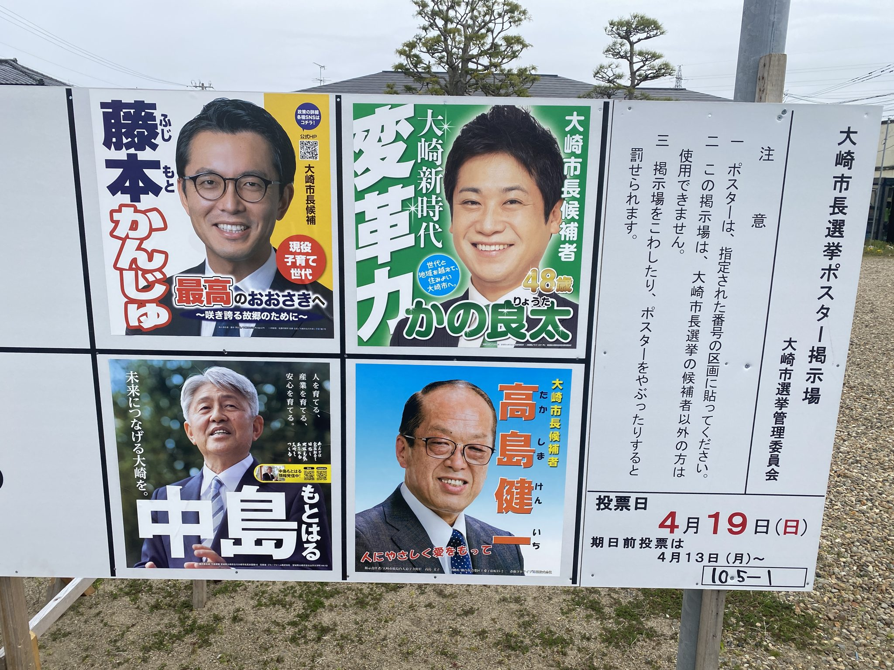
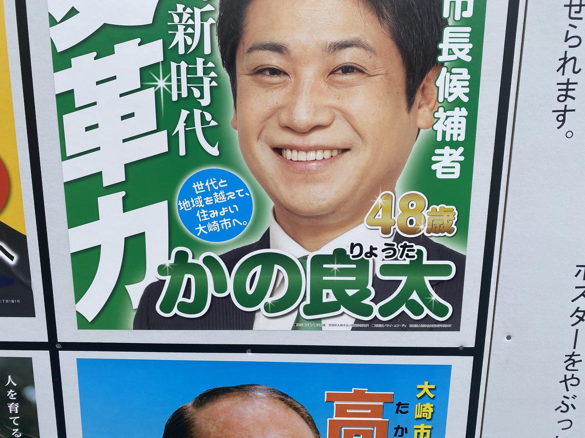
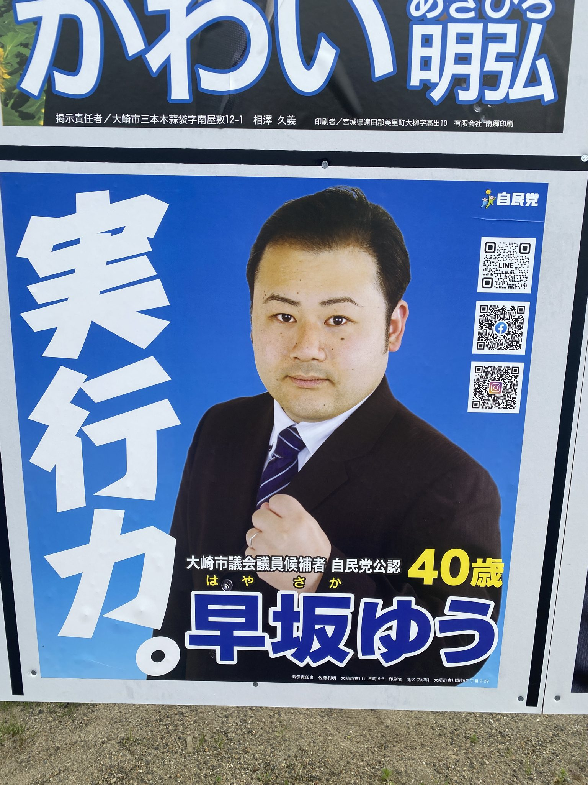

# 大崎市長選・市議選のポスター掲示場

Election poster boards, Osaki (2026-04-15)

- 日付: 2026-04-15
- 場所: 宮城県大崎市古川
- クレジット: 撮影: 畠山紳悟
- ライセンス: **CC BY 4.0**

2026年4月の大崎市長選挙・市議会議員選挙のポスター掲示場。

## 原本
**Internet Archive: https://archive.org/details/civicarchive-osaki-jls-20260415-poster**

予備（Google Drive）: https://drive.google.com/drive/folders/1RTxsAQsRHVimEnKvqN0dQdSpZwQ1VXj7

ここにあるのは閲覧用の縮小版（長辺2048px）です。

## 一覧
| プレビュー | 内容 |
|---|---|
|  | 大崎市長選挙のポスター掲示場（4候補のポスター） |
|  | 同・かの良太候補のポスター |
|  | 大崎市議選のポスター掲示場。早坂ゆう候補（自民党公認）のポスター |
